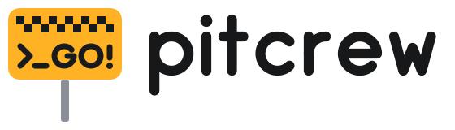

<h1 align="center">
  <picture>
    <source media="(prefers-color-scheme: dark)" srcset="assets/logo/pitcrew-lockup-dark.svg">
    
  </picture>
</h1>

The tools I built for my own iOS work, where one app is developed in many
places at once: several git worktrees, several simulators, several coding
agents.

They're public because seeing how a problem was already solved is often worth
more than starting from scratch. You don't need to adopt any of it. Each tool is
self-contained and optional.

| Tool | Problem it solves |
| --- | --- |
| [session-broker](session-broker) | Every simulator needs its own login, and rotating refresh tokens revoke each other. One local service shares the session and device ID across all simulators. |
| [local-review](local-review) | Agents write changes faster than you can review and merge them. A local review page ranks the diff and tracks each agent turn. Approving hands the merge back to the agent that wrote the change, through one merge queue. |
| [repository-lint](repository-lint) | Custom Swift rules need syntax-aware checks, changed-line filtering and a cached runner outside the app dependency graph. |
| [build-distro](build-distro) | Ad hoc build distribution services cost money or keep your builds on their servers. A small self-hosted server takes IPAs from CI in resumable parallel parts and gives testers a live install page. |
| [worktree-simulator](worktree-simulator) | Worktrees that share a simulator overwrite each other's app, Keychain and data. Each worktree gets its own device, created and deleted with it. |

I wrote about the workflow behind the session broker in
[Per-Worktree iOS Simulators with a Shared OAuth Session](https://mrozek.dev/posts/one-worktree-one-simulator-one-shared-session).

## Three ways to use this

**1. Run a tool as it is.** Pin a release tag and configure it from your own
repository: a Docker build from the tag, or this repository as a git submodule
checked out at it. Each tool's `examples/` folder shows exactly what to add.
Tags are per tool, for example `session-broker-v0.1.0`.

**2. Copy what you need.** Everything is MIT. Take one file, one pattern, or
one test.

**3. Have your agent build your own.** Your stack, naming and constraints are
different, and a version made for your project may fit better than mine. Point
your coding agent at the tool and its architecture notes:

```text
Build a simulator session broker for this project. Use
https://github.com/SzymonMrozek/pitcrew/tree/main/session-broker as a reference:
read its ARCHITECTURE.md first, keep the invariants it lists, and adapt the stack,
names and integration to this repository. Port the tests that describe the
behavior, then summarize what you changed and why.
```

## What each tool folder contains

| File | What it's for |
| --- | --- |
| `README.md` | What the tool does and how to run it. |
| `ARCHITECTURE.md` | Why it works this way: the decisions, the invariants that matter, what's incidental, and the pitfalls I hit. Read this one before building your own. |
| `examples/` | Integration code you can run or copy. |
| tests | The behavior, written down. Port them along with the idea. |

[AGENTS.md](AGENTS.md) tells coding agents how to read this repository.

## Status

I use these tools every day on a production iOS app. They change when my work
needs them to, and APIs can change before `1.0`. If you depend on one, pin a
tag. Issues and pull requests are welcome, but there's no support promise.

## Requirements

- Docker (Docker Desktop or Colima) for the session broker and build-distro
- Python 3.11+ and Git for local-review, plus [Worktrunk](https://github.com/max-sixty/worktrunk) to merge
- macOS with Xcode for the iOS examples and worktree-simulator

## Repository hygiene

```bash
git config core.hooksPath .githooks
```

The pre-push hook runs [`scripts/check-forbidden-terms.sh`](scripts/check-forbidden-terms.sh)
against each pushed commit’s tree and commit metadata, using a private list of
terms in `~/.config/pitcrew/forbidden-terms` (one
regex per line, kept outside the repository). That's how names from my private
projects stay out of public commits. The same trick works if you publish your
own tools. Run `scripts/check-forbidden-terms.sh` without arguments to check
the current tracked files before committing. Test the guard with
`python3 -m unittest discover -s scripts/tests`.

## License

[MIT](LICENSE)
