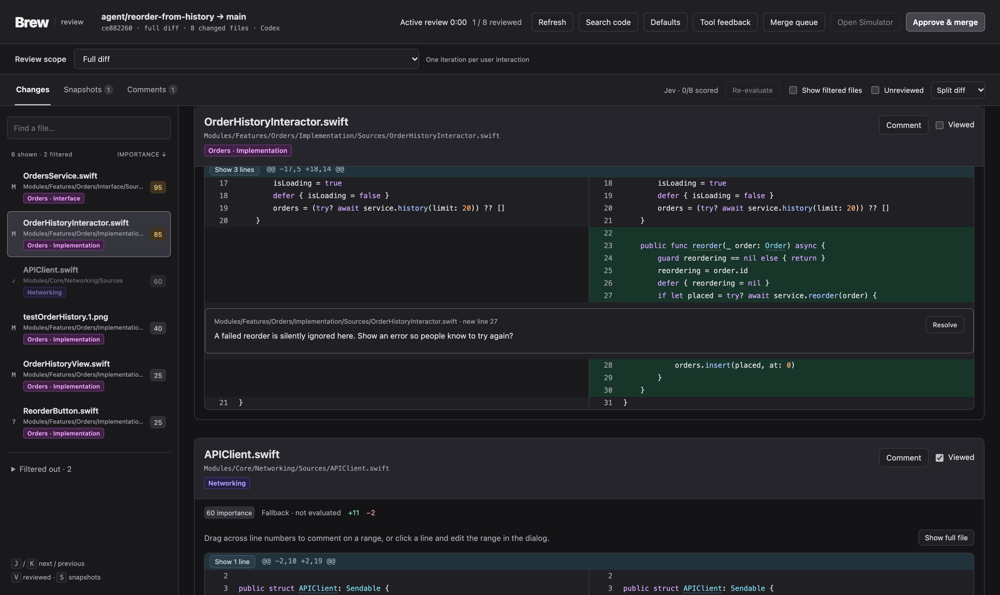
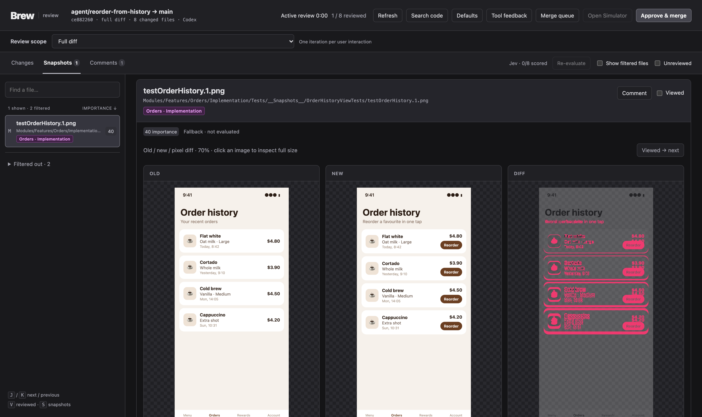
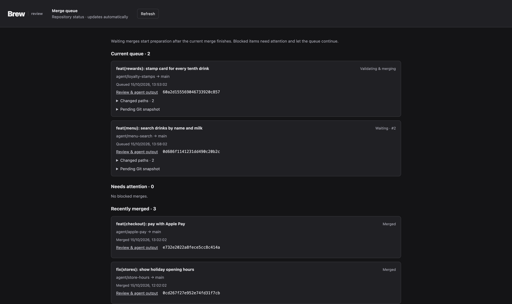

# local-review

A local code review page and merge queue for work done in git worktrees,
most of it by coding agents. You review a worktree's diff in the browser,
comment, and click **Approve & merge**. The tool then hands the merge back to
the Codex or Claude session that wrote the change. That agent rebases, handles
your comments, validates, squashes to one commit and merges with
[Worktrunk](https://github.com/max-sixty/worktrunk). Approvals from different
worktrees wait in one queue, so merges never race each other.

It's a Python standard-library server and plain browser JavaScript. There's no
build step, no dependency to install, and no hosting.



- **The diff you'd actually review:** the branch against its merge base, plus
  staged, unstaged and untracked files.
- **Importance ranking:** files sort by importance. Optionally,
  [Jev](#importance-ranking-with-jev) scores each diff.
- **Snapshots:** old, new and a pixel diff side by side, preloaded and scrolled
  as one feed.
- **Per-interaction history:** each user request to an agent is saved as an
  immutable before/after snapshot you can review on its own.
- **Code navigation:** search, jump to definition and callers, for Swift.
- **A merge queue** with private snapshots of pending approvals. Agents starting
  new work can see what's about to land and build on it.
- **Active review time:** counted only while you're actually interacting with
  the page.

## Requirements

- Python 3.11 or later and Git
- [Worktrunk](https://github.com/max-sixty/worktrunk) (`wt`) for merging, or
  another merge command you configure
- Codex CLI or Claude Code, to hand approvals to
- macOS with Xcode, only for **Open Simulator**

## Run it

Run it from the worktree you want to review:

```bash
python3 path/to/local-review/server.py
```

It prints a URL on `127.0.0.1`. Open it yourself; nothing opens a browser
automatically. Every worktree of a repository shares one server, on port 8732
at first. Its port and token persist in the Git common directory, so links stay
valid across restarts and reboots once you launch the tool again.

`--base <branch>` reviews against a local branch other than `main`. Run
`--help` for every command.

Most projects wrap the launcher, for example as a `mise` task, a Makefile
target or a script. Set `launcher` in the [configuration](#configuration) to
that command. The merge agent and the queue page give out commands built from
it.

Below, `review` stands for your launcher.

## Use it with agents

Coding agents start the review, record interaction boundaries and complete
approved merges. Add [examples/AGENTS.md](examples/AGENTS.md) to your
repository's agent instructions and adapt the commands. In short:

```bash
review --queue                          # what's pending, before starting a task
review --begin-iteration turn-3 --request "Improve snapshot navigation"
# ... the agent edits and validates ...
review --finish-iteration turn-3 --summary "Improved snapshot navigation" \
  --title "feat(review): add snapshot navigation" \
  --description-file /absolute/path/to/description.txt
```

`--finish-iteration` prints the full review URL and a link to this iteration.
The agent includes both in its reply. Titles must be Conventional Commits; the
title and description describe the whole branch, because they become the final
commit.

Agents must never open review or queue pages themselves, in any browser. If
they do, a background tab can count as your review time, and the page can
trigger actions you didn't take. The tool doesn't open browsers either.

## Reviewing

- **Filters.** Localization, tests and project manifests are hidden by default.
  **Defaults** can also hide views or match extra exclusion globs (`*` and `?`
  match across slashes). Expand **Filtered out** in the sidebar to see what's
  hidden and why. Snapshot images stay visible, even when they live next to tests.
- **Feeds.** **Changes** and **Snapshots** are continuous scrolling feeds. `J`/`K`
  move between files, `V` marks one viewed and moves on, and `S` toggles snapshots.
  Marking a file viewed is always explicit, never automatic on scroll.
- **Snapshots** show old, new and a highlighted pixel diff (exact RGBA,
  including size changes).

  
 Click an image to inspect it. Missing Git LFS
  objects are reported; the tool never downloads them.
- **Context.** Gap rows reveal 20 more lines at a time, or the whole gap.
  **Show full file** expands every gap. Expanded lines take comments too.
- **Comments.** Click a line number to comment on it, or drag across line
  numbers for a range. **⌘Enter** saves. Comments and viewed marks are stored
  locally per scope. A file that changes loses its viewed mark, and its old
  comments are marked outdated. Unresolved comments don't block a merge. The
  agent receives all of them with the approval.
- **Code navigation.** Swift type names declared in the repository link to
  their definitions, closest first: same file, same module, nearest path.
  Method names in `func` declarations open their callers. **Search code**
  (⇧⌘F) searches the diff, the changed files or the whole project.
- **Modules.** When you configure module patterns, each file shows its module
  and target, with one stable color per module.
- **Markdown** files offer **Preview Markdown**. Raw HTML is shown as text, and
  remote images aren't loaded.
- **Tool feedback** is an inbox for the review tool itself, separate from code
  comments. `review --feedback` lists open entries, and
  `review --implement-feedback <id>` marks one shipped.
- **Tab title.** The browser tab shows the originating agent's thread title,
  read from local Codex or Claude logs.

### Importance ranking with Jev

Files sort by one 0–100 importance score. Path is the tie-breaker.

Without an evaluator, scores come from the path and are labeled
**Fallback**. Localization, tests and manifests rank lowest, views low, and
code matching `files.important` (services, repositories, auth and similar)
high.

With `JEV_API_KEY` in the server's environment, Jev (Typesafe's evaluation
API at `api.typesafe.ai`) scores each actual diff with three evaluators: business logic and correctness,
performance, and significant UI changes. The score is the highest of the three,
and the page shows each signal. Large diffs are scored in bounded parts, taking
the maximum.

Some files never leave the machine and keep fallback scores:

- diffs that mention passwords, secrets, credentials, API keys or DSNs
- text files over 2 MB, or with oversized lines
- image pixels

Results are cached by content and by your evaluation preferences, which you
edit under **Defaults**.

**Priority paths** never score below 95, whatever the evaluator says. Use them
for code that defines contracts, such as module interfaces.

## Approve and merge

**Approve & merge** shows a summary of the full branch. **Ask agent to merge**
saves a durable approval and starts a separate, non-interactive run of the
agent that wrote the change. The button itself doesn't stage, commit or merge
anything.

The worker waits for its turn in the [queue](#merge-queue). Then it:

1. fetches the target's upstream, if it has one, and rebases onto the latest target
2. reads the full diff and your comments, then fixes what's needed: failing
   checks, conflicts, actionable comments
3. runs `review --execute-merge-request <id>` with a final commit title and description

Approval covers the corrections needed to finish the task. Routine fixes and a
moving target don't need fresh approval. A changed diff that you didn't
approve does: approval is tied to the reviewed files' paths, contents and
modes, not to the target's commit.

Execution:

1. checks that the approval is still pending, on the intended branch and target
2. runs each configured merge check whose paths match, such as launching the app
3. freezes the prepared files and stages them
4. backs up the branch tip to `refs/wt-backup/<branch>`
5. squashes to one commit with your description as its body
6. runs the merge command (`wt merge <target> --no-commit --no-rebase` by
   default), which runs your Worktrunk hooks and removes the worktree

It never pushes. A failed attempt returns the same approval to pending, so the
agent fixes the cause and retries.

**Agent output** in the review page streams the worker's messages and commands.
**Download full log** has the rest. When the worker finishes, you can open its
actual conversation in Codex or Claude, or copy a `claude --resume` command.
These controls stay disabled while the worker runs: resuming a live headless
session can interrupt the merge.

You can withdraw an approval while it's pending. Any preparation the agent
already did stays in the worktree.

## Merge queue

**Merge queue** opens the repository's queue: approvals in arrival order, ones
that need attention, and the last 20 merges.


 `review --queue` prints it as JSON
without starting a server. `review --queue-page` prints the URL of a standalone
page.

The queue is one lock held from preparation through cleanup. A waiting
approval costs nothing: no agent run, rebase or tests start until its turn. A
blocked worker moves to **Needs attention**, and the queue continues.

Every pending approval has a private snapshot commit containing the complete
approved files, including uncommitted ones, on top of its merge base.
An agent starting dependent work can build on it:

```bash
review --queue
git diff <snapshotBase> refs/<name>/queue/<id> -- path/to/component
git merge --no-edit refs/<name>/queue/<id>   # in your own worktree
```

Wait for those dependencies to land before approving your own review, so their
changes don't show up in your diff.

`review --resume-merge-request <id>`, run from the request's worktree, restarts
a stopped worker in its original queue position.

## Interaction history

**Review scope** offers:

- **Full diff:** the live branch against its merge base.
- **This thread:** only the edits recorded by this chat's interactions.
  Dependencies imported between interactions stay out of it.
- **Each interaction:** immutable snapshots taken right before and after one
  user request, shown with that request and its summary.

Snapshots are Git tree objects written through a private index and kept under
`refs/<name>/<review>/…`. They include untracked files, deletions, modes and
symlinks, and never touch `HEAD` or your staging index. Nothing appears in
branch history. They survive worktree removal, and saved reviews of removed
worktrees stay readable.

## Open Simulator

**Open Simulator** boots the worktree's dedicated simulator if needed. Then it
selects that device in Xcode's Devices window, through
`devices:///manage/select?id=<udid>`. It reads the UDID from the worktree's
metadata file, for example one written by
[worktree-simulator](../worktree-simulator). It never falls back to another
device.

## Active review time

The header shows time spent actively reviewing. Time counts only when all of
these are true:

- the tab is visible
- the window has focus
- there was real mouse, keyboard, scroll or touch input in the last two minutes

It stops once a merge is requested, and saved merge views never count. Counters
are stored per scope and page visit, along with the counted intervals, and are
included in **Export comments**. Nothing is uploaded.

## Configuration

The tool reads `.config/local-review.toml` from the repository root.
`LOCAL_REVIEW_CONFIG` points somewhere else. Every key is optional;
[examples/local-review.toml](examples/local-review.toml) documents all of them.

| Key | Default | What it sets |
| --- | --- | --- |
| `name` | `local-review` | State directory in the Git common dir, ref namespace, and `<NAME>_HANDOFF`/`<NAME>_QUEUE_PID` variables |
| `title` | `Local` | Brand word in the page header and tab |
| `launcher` | `python3 <path>/server.py` | Command given to agents and on the queue page |
| `[files]` | iOS defaults | Regexes for snapshot, localization, manifest, test and view files, and `important` |
| `[[priority]]` | none | `pattern` and `label` for paths that never score below 95 |
| `[[modules]]` | none | JavaScript regexes with `name`, `group` and `target` named groups |
| `[simulator]` | `.worktree-simulator/simulator.env` | Metadata file and the keys holding the UDID and name |
| `[merge]` | `wt merge {target} --no-commit --no-rebase` | `command`, extra agent `instructions`, and `[[merge.checks]]` (`paths`, `command`) |

## Storage and security

Settings, scores, comments, approvals, logs and server metadata live in
`<git-common-dir>/<name>/`, outside version control. They're shared by all
worktrees and survive worktree removal. To stop the server, use the PID in
`shared-server.json` there.

The server binds to `127.0.0.1` only and checks `Host` and `Origin`. It
authenticates with a token kept in the URL fragment, sent as a header. Code and
comments are rendered as text. Anyone with a review URL can use that review,
so keep it local.

## Limitations

- A rename shows as a deletion and an addition.
- Text files over 2 MB and other binary files need an editor.
- Pixel diffs are exact, not perceptual.
- Definitions and callers are text-based and Swift-only.

## Tests

```bash
python3 tests/test_server.py
node --test tests/*.test.mjs
```

The server tests use throwaway Git repositories. One of them runs a real
Worktrunk merge in a disposable worktree, and is skipped when `wt` isn't
installed.

Read [ARCHITECTURE.md](ARCHITECTURE.md) before building your own.
